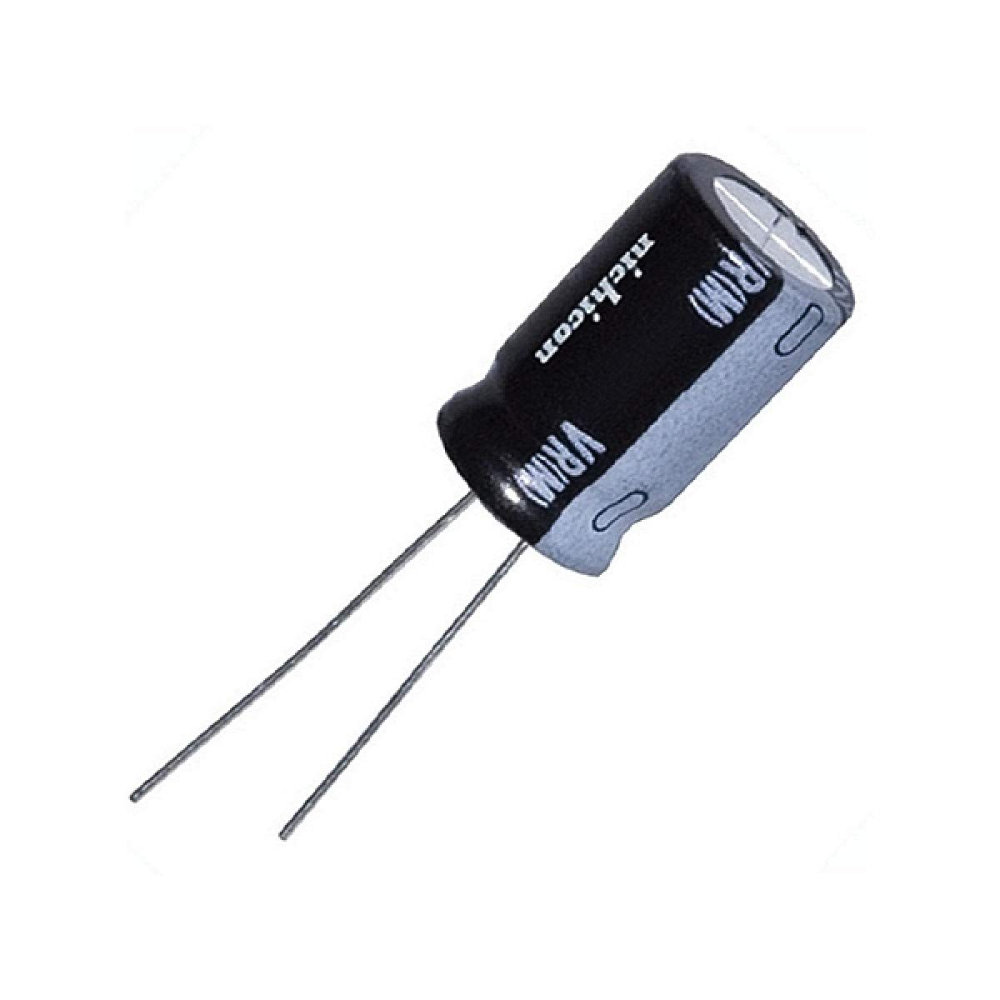

# Electrónica básica
Bienvenidos a este segundo proyecto de la asignatura, Electrónica básica. Aquí vamos a ver y analizar los distintos componentes que podemos utilizar en un circuito. Vamos a dividir este README en varios apartados en referencia a cada componente. Nos vamos a centrar en qué son, para qué sirven, su funcionamiento interno, su símbolo eléctrico, una imagen real, algunas aplicaciones o usos que les podamos dar y las distintas variedades que tienen: 

## Resistencias fijas
Las resistencias fijas son un componente electrónico pasivo cuya función principal es oponerse al paso de la corriente eléctrica con un valor de resistencia único y constante que no se puede modificar. Este valor ya viene de fábrica, y no se puede modificar. Para eso ya tenemos las resistencias variables, que veremos ahora. Justo debajo podemos ver una imagen de una resistencia fija, en la que nos podemos fijar que tiene dos patillas y diferentes líneas de color, las cuales veremos posteriormente:

Al contrario que otros componentes, estas no tienen polaridad, esto quiere decir que da igual en que sentido pongas sus dos patillas que tiene, puedes conectarlas al positivo y negativo o al revés. Su unidad de medida son los ohmios (Ω), que miden la cantidad de resistencia, como su nombre indica, que se opone a la corriente. Podemos identificar cuantos ohmios tiene según las bandas de color que he mencionado antes. Según el color, obtienen un valor u otro. Para eso, podemos fijarnos en una tabla de referencia con la que identificamos los valores fácilmente, con los distintos códigos de color y la tolerancia, que explicaré ahora. Podemos ver una imagen justo debajo:

Resistencia RED-RED-BROWN-GOLD: 220 ohmios. Tolerancia ±5%

## Resistencias variables (Potenciómetro, NTC, PTC, y LDR)

### Potenciómetro
Valor total del potenciómetro=435k
Patilla izquierda=240k 
" derecha= 103k

### LDR

830 Ω con luz ambiental
3450 Ω con luz tapada

### NTC

### PTC

## Condensadores
Un condensador es un componente electrónico pasivo con dos terminales que almacena energía de forma temporal en un campo eléctrico. Existen dos tipos de condensadores según sus terminales. Unos tienen polaridad, es decir que tienes que conectar un terminal al positivo y otro al negativo, y no se puede cambiar. Y los otros no tienen polaridad, es decir, da igual donde conectes el positivo y negativo, no interfiere. Por dentro, están compuestos de dos tiras de aluminio, y entre estos hay una tira de papel o cerámica que actúa como aislante. 

Al aplicarle un voltaje, las cargas eléctricas se acumulan en las placas. Este no es como la batería, no almacena la energía con procesos químicos, sino de manera electroestática. Esto le permite cargar y descargar la energía de forma rápida. Su capacidad de guardar la carga eléctrica se mide en Faradios (F). Normalmente, no se suelen medir en así, se suelen medir en microfaradios (µF) o milifaradios (mF). Aquí podemos observar una imagen sobre el condensador: 

Medición de tiempo de apagado del LED: 7,12";7,13";7,08";7,58";7,34";7,46"- Media total: 7,29" 

## Diodos (Normal, Zener y LED)

### Diodo normal

### Diodo Zener

### Diodo LED

Antonio nos propuso la siguiente cuestión. Trataba de lo siguiente: Calcular el voltaje de la fuente de alimentación necesario para hacer funcionar un diodo LED azul, sabiendo que el diodo LED está protegido por una resistencia, teniendo en cuenta también la intensidad del LED. Cada un tiene sus valores, que nos dio Antonio a cada uno al azar. Debajo podemos ver el ejercicio propuesto con la fórmula a seguir. Lo único que debemos hacer es sustituir los valores que nos otorgó Antonio a cada uno. Mis valores fueron los siguientes: 

·LED de color azul con una intensidad de 0'02 A y un consumo de voltaje de 4'6 V. 
·Resistencia de 4 bandas: Rojo-Rojo-Marrón-Dorado. Esto equivale a 220 Ω, con una tolerancia de ±5%.

Ahora, debemos averiguar el voltaje que le debemos proporcionar al LED desde la fuente de alimentación, teniendo en cuenta los valores anteriores. 
Resistencia=(Voltajefuente-VoltajeLED)/IntensidadLED ⟶ 220Ω=(Vfuente-4'6V)/0'02A ⟶ 220Ω*0'02A+4'6V=Vfuente ⟶ 9=Vfuente

## Transistores

Distribución NPN (No penetra) Código CBC 548 C. 38 veces más.
## Relés

